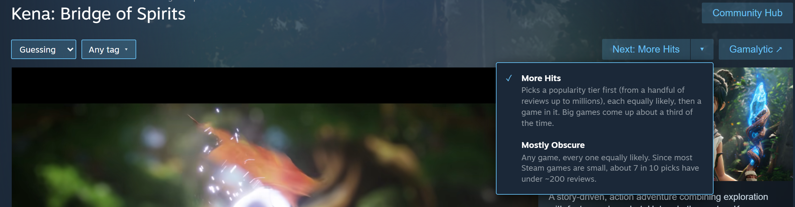
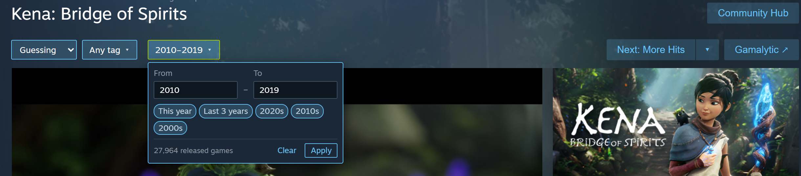
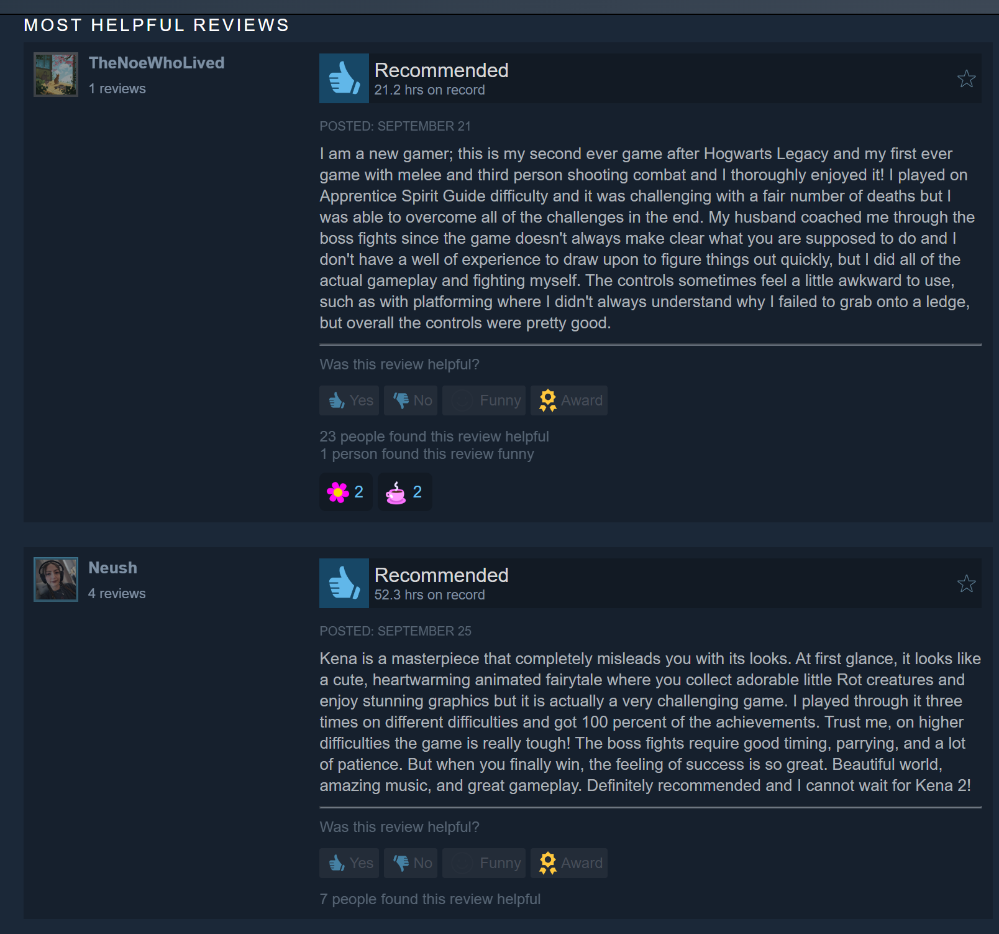
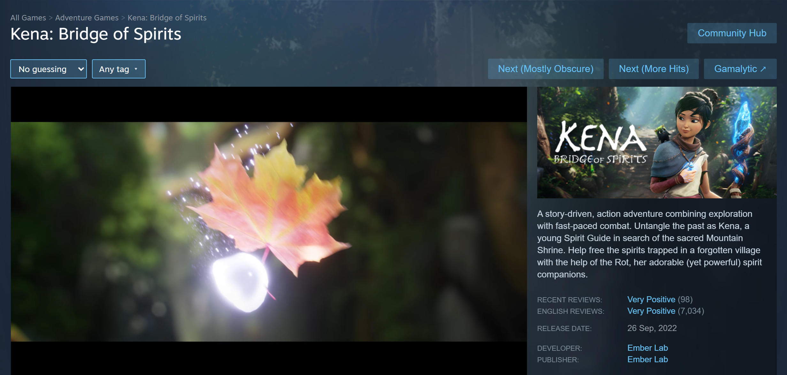
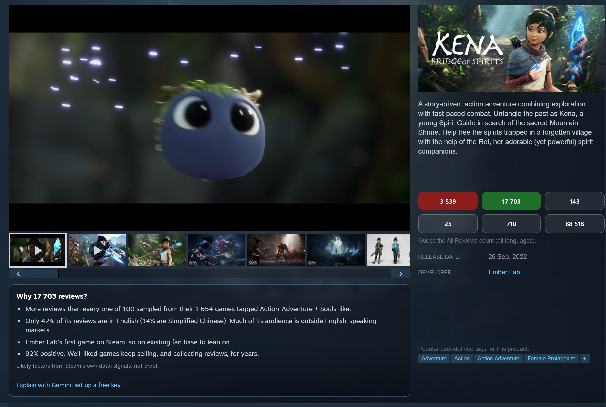
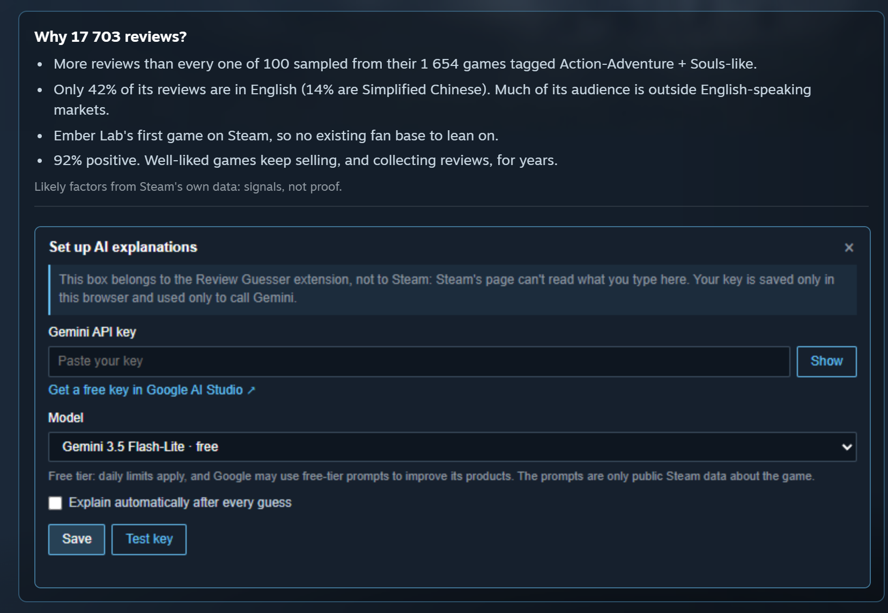

# Jonas Review Guesser

> **This is a fork** of [LooveToLoose/Jonas-Review-Guesser](https://github.com/LooveToLoose/Jonas-Review-Guesser).
> It builds on [rsdal's fork](https://github.com/rsdal/Jonas-Review-Guesser) and adds a few things of its own.
> Everything below "Overview" is the original README, updated where this fork behaves differently.

## What's Different in This Fork

**Added here**
- **Multi-tag filter.** A searchable tag picker next to the Next button. Pick as many tags as you like (e.g. Third Person + Combat + Indie) and Next only sends you to games that have all of them. See [Tag Filter](#tag-filter) for a screenshot and details.
- **Year filter.** Limit Next to games released in a range of years (e.g. 2010–2019), with tags too. See [Year Filter](#year-filter).
- **Guessing modes.** A dropdown in the toolbar: **Guessing** (the classic game), **Guessing + review comments** (guess, but read what players wrote; totals and scores stay hidden), or **No guessing** (the normal Steam page). No more going to `chrome://extensions` to read reviews. See [Guessing Modes](#guessing-modes).
- **Gamalytic link.** A **Gamalytic ↗** button at the end of the toolbar row opens the game's [Gamalytic](https://gamalytic.com) page in a new tab: estimated copies sold, revenue, players and more. Handy after you guess. *(Spoiler: that page shows the review count.)*
- **Own toolbar row.** All of this sits in a row under the game title instead of squeezing into the title row, so long names stay on one line and Steam's **Community Hub** button stays put.
- **One Next button, clearer modes.** The two Next buttons are now one **Next** with a ▾ menu: **More Hits** (was "Balanced") or **Mostly Obscure** (was "Raw"), each explained in the menu and remembered. See [Random Game Navigation](#random-game-navigation).
- **"Why N reviews?" insights.** After you guess, a box under the screenshots with the likely reasons for the count from Steam's own data, plus an optional explanation written by Google's Gemini, free with a Gemini API key. See [Why N Reviews?](#why-n-reviews-insights).
- **Fixed: the answer is really all languages now.** Steam's redesigned review section only shows the count for your languages, so the game had been asking for "all languages" while using the English count (Kena: 7,034 instead of 17,703). The answer now comes from Steam's review API.
- **Fixed: Steam pages freezing.** Some pages, especially ones still loading or pre-purchase games with no reviews yet, hung with Chrome's "Page unresponsive" dialog. The extension's review-count watcher was triggering itself in an endless loop. It now checks at most every 100 ms, and only one check runs per page.

**From rsdal's fork**
- The first version of the tag filter (one tag at a time, "Balanced" button only). The tag list in `src/tags.js` comes from it.
- More reliable review-count detection across Steam's different page layouts, and hiding of the "all languages" review count.

## Overview

Jonas Review Guesser is a Chrome extension that turns Steam into a review guessing game. It hides the review count (and some other clues) on Steam store pages and asks you to guess the number of reviews instead. On top of that, it adds buttons at the top of the page that take you to completely random games on Steam, giving you a new way to browse the store, step outside your usual bubble, and gradually improve your intuition for how successful different games are.


### Random Game Navigation

One **Next** button with a **▾** next to it: the ▾ picks how Next chooses a game, and the choice is remembered (the button shows it, e.g. **Next: More Hits**).



- **Mostly Obscure** *(was "Next (Raw)")*
  - Any Steam game, every one equally likely.
  - Most games on Steam are small, so about 7 in 10 picks have under ~200 reviews: lots of obscure titles and shovelware, and the right answer is usually a small number.
- **More Hits** *(was "Next (Balanced)"; the default)*
  - First picks a popularity tier, each equally likely, then a game inside it. The bundled game lists are grouped by review count:

    | Tier | Games | Typical reviews | Chance with Mostly Obscure | Chance with More Hits |
    |---|---|---|---|---|
    | 1 | 78,358 | under ~200 | 69% | 17% |
    | 2 | 19,188 | ~50 – 200 | 17% | 17% |
    | 3 | 9,748 | ~300 – 700 | 9% | 17% |
    | 4 | 4,287 | ~2k – 6k | 4% | 17% |
    | 5 | 1,748 | ~15k – 35k | 1.5% | 17% |
    | 6 | 684 | 40k – millions | 0.6% | 17% |

    *(Review counts sampled in October 2026; the lists are from 2025, so the lower tiers overlap a little now.)*
  - Big games (15k+ reviews) come up about a third of the time instead of ~2%, and the answers range from tens to millions. That makes for harder, more varied guessing.

### Tag Filter


- The tag button next to the Next button opens a picker with every Steam tag. Pick as many as you like (e.g. **Third Person + Combat + Indie**).
  - Type to search, **Enter** toggles the first match, click a chip to remove a tag, **Clear** removes them all.
  - After the tag and year buttons you see how many games Next can pick from: games with **all** the selected tags, or, with a year range set, released games from those years with those tags. If none match, Next says so instead of sending you somewhere random.
- With tags selected, Next only picks games (no DLC or soundtracks) that have every selected tag:
  - **Mostly Obscure**: any of the matches, all equally likely.
  - **More Hits**: Steam's relevance order (which mostly follows popularity) is split into tiers that grow 4x (top 25, next 75, next 300, ...); a tier is picked at random, then a game inside it. Popular games come up often, but any match can.
- Your selection is remembered. With no tags selected the buttons work exactly as before. If you used rsdal's single-tag dropdown, your tag carries over.
- Tag-filtered picks come from Steam's live search, so they include brand-new releases that aren't in the bundled appID lists.

### Year Filter



- The **Any year ▾** button next to the tag picker limits Next to games **released** in a range: type **From** / **To** (either can be left empty, e.g. "2015 or later"), or use a preset (This year, Last 3 years, 2020s, 2010s, 2000s). The count after the year button then shows how many released games match, tags included.
- Works with tags and with both Next modes:
  - **Mostly Obscure**: Steam's newest-first list of released games is binary-searched for the range's two edges (about a dozen lookups the first time, then cached for a day), then a game is picked uniformly inside it.
  - **More Hits**: the usual popularity tiers, keeping only games from the range.
- Unreleased games are left out while a year range is set.
- The year is Steam's release date. For re-releases that's when the game came to Steam, which can differ from an original date the store page shows (e.g. a 2006 game re-released on Steam in 2015 counts as 2015).

### Guessing Modes

The dropdown at the start of the toolbar row (before the tag picker) picks how the page is shown:

| Mode | Guess buttons | Review counts | Review score ("Mixed", "Very Positive") and filters | Review comments | Publisher, curators, awards, ... |
|---|---|---|---|---|---|
| **No guessing** | – | shown | shown | shown | shown |
| **Guessing** | ✔ | hidden | hidden | hidden | hidden |
| **Guessing + review comments** | ✔ | hidden | **shown** | **shown** | hidden |

- **Guessing + review comments** lets you read what players wrote before you guess. Steam's review section shows as usual (title, the Overall Reviews score, the filter dropdowns, the comments) with **every count hidden**: the "(52 reviews)" next to the score, the "Total reviews in all languages" lines, the counts inside the dropdown options, "Show graph", and "Showing N reviews". Games with under 10 reviews show "N user reviews" in place of a score, so that box stays hidden. *(Each review still shows its own "N people found this helpful".)*
- **No guessing** is the normal Steam page. The Next button and tag picker keep working.
- The mode is remembered (it applies before the page draws, so nothing flashes) and other open Steam tabs follow it. Switching mid-page takes effect right away. If you leave it on **No guessing**, the next game's reviews will be visible too.

**Guessing + review comments**



**No guessing**



### Why N Reviews? (Insights)

After you guess, a box under the screenshots lists the strongest likely reasons for the count:



- Built for free from Steam's own public data (about 10 requests, made only after you guess). It checks:
  - how the game compares with ~100 sampled games sharing its most specific tags
  - age and reviews per year, price or free-to-play
  - the studio's earlier (or later) hits, and the publisher's reach
  - the language split ("only 7% English, 87% Simplified Chinese")
  - review score, Early Access, sequel, multiplayer, Metacritic, DLC
- The top 4 are shown. They're heuristics: signals, not proof.

#### Explain with Gemini (optional, free)

Below the insight, **Explain with Gemini** sends the same facts to Google's Gemini and shows a 2-3 sentence explanation. It uses the Gemini API's **free tier**: no charge, but daily limits apply, and Google may use free-tier prompts to improve its products. The prompts are only public Steam data about the game.

1. Create a free API key in Google AI Studio (aistudio.google.com/apikey).
2. Guess on any game, then click **Explain with Gemini: set up a free key** under the insight. A setup box opens right there on the page.
3. Paste the key, pick a model (**Gemini 3.5 Flash-Lite**, or **Gemini 3.8 Flash** for better writing; both free), click **Save**. **Test key** checks the key and model without generating anything.
4. **AI settings** under the insight reopens the box later (change model, remove the key).



- If Gemini says the free-tier limit is used up, try again later (limits reset at midnight Pacific time) or switch to the other model.
- The model is shown under each explanation. Optionally, turn on **Explain automatically after every guess**.

The setup box is the extension's own page shown inside Steam's page, so Steam's scripts can't read what you type into it. The same settings are also on the extension's options page (right-click the extension's icon → **Options**).

**Your key stays yours.** It's saved only in your browser profile (`chrome.storage.local`), never in the extension's files, so forks of this repo don't contain it. Anyone else using the extension needs their own key. Calls go from the extension's background worker straight to `generativelanguage.googleapis.com`; Steam's pages never see the key.

## Limitations

It is a very simple application with many limitations:
- **Bug: ** Current version only works when your Steam is set to English.
- Somewhat hinders your normal Steam browsing experience. *(This fork: pick **No guessing** in the header dropdown instead of disabling the extension.)*
- The database of appIDs is not automatically updated so the newer titles might not be included.
- Sometimes the extension brings you to a Steam page that is not or no longer available in your region.
- Lacking a lot of features that might be cool e.g. entering the guess into a text field, etc. etc.
- Tag filter: Steam's search matches tags beyond the ~20 a store page displays, so now and then a game won't *show* one of your selected tags even though Steam has it tagged that way.
- Guessing + review comments finds the comments by Steam's English headings ("Most Helpful Reviews", "Recently Posted"). If Steam changes its review layout, the comments just stay hidden; totals never leak.
- Tag filter: tags can only be combined as "must have all". There's no "any of these" or "exclude this tag" yet.

It is not my plan to work on this too much more so if you'd like to see these limitations resolved, fork it and do it yourself! I'd be happy to try out your version. :)

## Installation (Local Chrome Extension)

### Prerequisites

- **Google Chrome** installed.
- The extension source code downloaded:
  - Either via `git clone`:
    ```bash
    git clone https://github.com/pau1o-hs/Jonas-Review-Guesser
    ```
  - Or by downloading a ZIP and extracting it.

### Step 1: Open Chrome Extensions Page

- In Chrome, go to:
  - `chrome://extensions/`
- Enable **Developer mode**:
  - Toggle the **Developer mode** switch in the top-right corner.

### Step 2: Load the Unpacked Extension

- Click **“Load unpacked”**.
- Select the folder containing the extension:
  - The folder that includes `manifest.json`.
- Confirm that **Jonas Review Guesser** appears in the list of extensions.

### Step 3: Set Steam language to ENGLISH!
- **Set your language to "English"!** This is crucial for the current version to work.

### Step 4: Verify It Works

- Make sure the extension is **enabled** (toggle is on).
- Open any Steam store page:
  - Check if:
    - Review counts are replaced with guess buttons.
    - The **Next** button (with its ▾ menu) appears at the top of the page.
    - The **Guessing** dropdown and the tag button (**Any tag** until you pick some) appear before them, and **Gamalytic ↗** after them.

---

## Enabling / Disabling the Extension

### Enable

- Go to `chrome://extensions/`.
- Find **Jonas Review Guesser**.
- Ensure the toggle is switched **on**.

### Disable

- Go to `chrome://extensions/`.
- Find **Jonas Review Guesser**.
- Switch the toggle **off** to temporarily disable it.
- (Optional) Click **Remove** if you want to uninstall it completely.

---

## Updating the Extension

### When You Pull New Changes (Git) or Download a New Version

- If you updated the extension files by:
  - Running `git pull` in the project folder, or
  - Replacing the folder with a newer version,

do the following:

### Step 1: Go to the Extensions Page

- Open `chrome://extensions/`.
- Ensure **Developer mode** is still enabled.

### Step 2: Reload the Extension

- Find **Jonas Review Guesser**.
- Click the **Reload** button (⟲) on the extension card.
  - This loads the latest version of the source from the folder.

### Step 3: If Something Breaks

- Disable and re-enable the extension.
- If issues persist:
  - Click **Remove**.
  - Then click **Load unpacked** again and select the updated folder.

---

## License

- Short summary:
  - Non-commercial use only.
  - Forking, modifying, and renaming allowed.
  - Giving credit is not required.
  - No warranty, no support, use at your own risk.

See the license file for more details.

## FAQ

*(Answered by the original author.)*

> Will there be a Firefox version?

Only if one of you makes one.

> Can you add *(insert any feature)* to this extension?

Probably not. I'm happy to try out your version if you add any cool stuff.

> I think it should be different. I think it should be...

Okay. Just make it.

> Can you make a YouTube video guessing our Steam games?

Sure, I'll do that on my YT channel (@jonastyroller) and Discord. Sounds like a great idea. 

