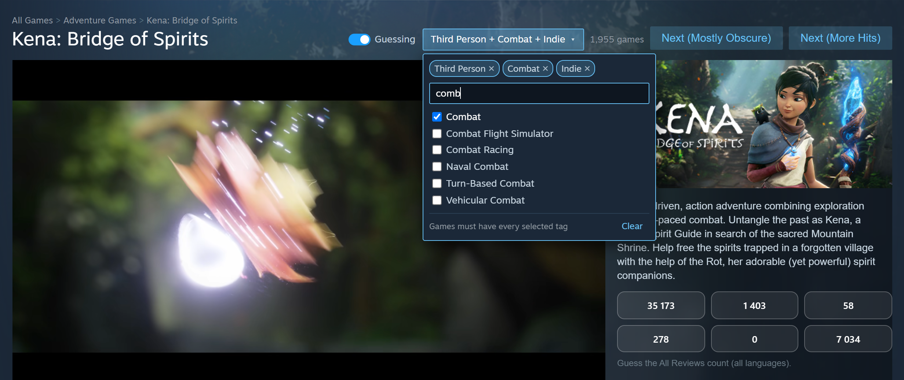
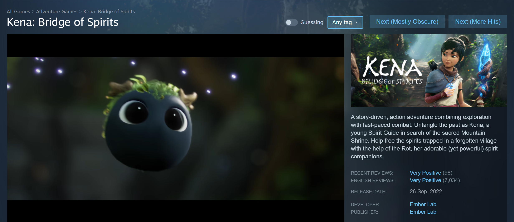

# Jonas Review Guesser

> **This is a fork** of [LooveToLoose/Jonas-Review-Guesser](https://github.com/LooveToLoose/Jonas-Review-Guesser).
> It builds on [rsdal's fork](https://github.com/rsdal/Jonas-Review-Guesser) and adds a few things of its own.
> Everything below "Overview" is the original README, updated where this fork behaves differently.

## What's Different in This Fork

**Added here**
- **Multi-tag filter.** A searchable tag picker next to the Next buttons. Pick as many tags as you like (e.g. Third Person + Combat + Indie) and both Next buttons only send you to games that have all of them. See [Tag Filter](#tag-filter) for a screenshot and details.
- **Guessing on/off switch.** A **Guessing** switch in the page header. Turn it off to see the page normally (reviews and comments, publisher, curators, ...), turn it back on to hide them and get the guess buttons. No more going to `chrome://extensions` to read reviews. See [Guessing Switch](#guessing-switch).
- **Clearer button names.** "Next (Raw)" is now **Next (Mostly Obscure)** and "Next (Balanced)" is now **Next (More Hits)**, each with a tooltip saying how it picks. See [Random Game Navigation](#random-game-navigation).
- **Fixed: Steam pages freezing.** Some pages, especially ones still loading or pre-purchase games with no reviews yet, hung with Chrome's "Page unresponsive" dialog. The extension's review-count watcher was triggering itself in an endless loop. It now checks at most every 100 ms, and only one check runs per page.

**From rsdal's fork**
- The first version of the tag filter (one tag at a time, "Balanced" button only). The tag list in `src/tags.js` comes from it.
- More reliable review-count detection across Steam's different page layouts, and hiding of the "all languages" review count.

## Overview

Jonas Review Guesser is a Chrome extension that turns Steam into a review guessing game. It hides the review count (and some other clues) on Steam store pages and asks you to guess the number of reviews instead. On top of that, it adds buttons at the top of the page that take you to completely random games on Steam, giving you a new way to browse the store, step outside your usual bubble, and gradually improve your intuition for how successful different games are.


### Random Game Navigation

- **Next (Mostly Obscure)** *(was "Next (Raw)")*
  - Any Steam game, every one equally likely.
  - Most games on Steam are small, so about 7 in 10 picks have under ~200 reviews: lots of obscure titles and shovelware, and the right answer is usually a small number.
- **Next (More Hits)** *(was "Next (Balanced)")*
  - First picks a popularity tier, each equally likely, then a game inside it. The bundled game lists are grouped by review count:

    | Tier | Games | Typical reviews | Chance with Mostly Obscure | Chance with More Hits |
    |---|---|---|---|---|
    | 1 | 78,358 | under ~200 | 69% | 17% |
    | 2 | 19,188 | ~50 – 200 | 17% | 17% |
    | 3 | 9,748 | ~300 – 700 | 9% | 17% |
    | 4 | 4,287 | ~2k – 6k | 4% | 17% |
    | 5 | 1,748 | ~15k – 35k | 1.5% | 17% |
    | 6 | 684 | 40k – millions | 0.6% | 17% |

    *(Review counts sampled in October 2026; the lists are from 2025, so the lower tiers overlap a little now.)*
  - Big games (15k+ reviews) come up about a third of the time instead of ~2%, and the answers range from tens to millions. That makes for harder, more varied guessing.

### Tag Filter



- The tag button next to the Next buttons opens a picker with every Steam tag. Pick as many as you like (e.g. **Third Person + Combat + Indie**).
  - Type to search, **Enter** toggles the first match, click a chip to remove a tag, **Clear** removes them all.
  - Next to the button you see how many games have **all** the selected tags. If none do, the Next buttons say so instead of sending you somewhere random.
- With tags selected, both buttons only pick games (no DLC or soundtracks) that have every selected tag:
  - **Next (Mostly Obscure)**: any of the matches, all equally likely.
  - **Next (More Hits)**: Steam's relevance order (which mostly follows popularity) is split into tiers that grow 4x (top 25, next 75, next 300, ...); a tier is picked at random, then a game inside it. Popular games come up often, but any match can.
- Your selection is remembered. With no tags selected the buttons work exactly as before. If you used rsdal's single-tag dropdown, your tag carries over.
- Tag-filtered picks come from Steam's live search, so they include brand-new releases that aren't in the bundled appID lists.

### Guessing Switch



- The **Guessing** switch sits at the start of the header row, before the tag picker.
- **Off:** the page looks like normal Steam: review summaries, the review comments, publisher, curators, awards, etc. The guess buttons disappear. Next buttons and the tag picker keep working.
- **On:** everything is hidden again and the guess buttons appear, even mid-page.
- The setting is remembered (it applies before the page draws, so nothing flashes) and other open Steam tabs follow it. Remember to turn it back on before you hit Next, or the next game's reviews will be visible.

## Limitations

It is a very simple application with many limitations:
- **Bug: ** Current version only works when your Steam is set to English.
- Somewhat hinders your normal Steam browsing experience. *(This fork: flip the **Guessing** switch off instead of disabling the extension.)*
- The database of appIDs is not automatically updated so the newer titles might not be included.
- Sometimes the extension brings you to a Steam page that is not or no longer available in your region.
- Lacking a lot of features that might be cool e.g. entering the guess into a text field, etc. etc.
- Tag filter: Steam's search matches tags beyond the ~20 a store page displays, so now and then a game won't *show* one of your selected tags even though Steam has it tagged that way.
- Tag filter: tags can only be combined as "must have all". There's no "any of these" or "exclude this tag" yet.

It is not my plan to work on this too much more so if you'd like to see these limitations resolved, fork it and do it yourself! I'd be happy to try out your version. :)

## Installation (Local Chrome Extension)

### Prerequisites

- **Google Chrome** installed.
- The extension source code downloaded:
  - Either via `git clone`:
    ```bash
    git clone https://github.com/pau1o-hs/Jonas-Review-Guesser
    ```
  - Or by downloading a ZIP and extracting it.

### Step 1: Open Chrome Extensions Page

- In Chrome, go to:
  - `chrome://extensions/`
- Enable **Developer mode**:
  - Toggle the **Developer mode** switch in the top-right corner.

### Step 2: Load the Unpacked Extension

- Click **“Load unpacked”**.
- Select the folder containing the extension:
  - The folder that includes `manifest.json`.
- Confirm that **Jonas Review Guesser** appears in the list of extensions.

### Step 3: Set Steam language to ENGLISH!
- **Set your language to "English"!** This is crucial for the current version to work.

### Step 4: Verify It Works

- Make sure the extension is **enabled** (toggle is on).
- Open any Steam store page:
  - Check if:
    - Review counts are replaced with guess buttons.
    - The **Next (Mostly Obscure)** and **Next (More Hits)** buttons appear at the top of the page.
    - The **Guessing** switch and the tag button (**Any tag** until you pick some) appear next to them.

---

## Enabling / Disabling the Extension

### Enable

- Go to `chrome://extensions/`.
- Find **Jonas Review Guesser**.
- Ensure the toggle is switched **on**.

### Disable

- Go to `chrome://extensions/`.
- Find **Jonas Review Guesser**.
- Switch the toggle **off** to temporarily disable it.
- (Optional) Click **Remove** if you want to uninstall it completely.

---

## Updating the Extension

### When You Pull New Changes (Git) or Download a New Version

- If you updated the extension files by:
  - Running `git pull` in the project folder, or
  - Replacing the folder with a newer version,

do the following:

### Step 1: Go to the Extensions Page

- Open `chrome://extensions/`.
- Ensure **Developer mode** is still enabled.

### Step 2: Reload the Extension

- Find **Jonas Review Guesser**.
- Click the **Reload** button (⟲) on the extension card.
  - This loads the latest version of the source from the folder.

### Step 3: If Something Breaks

- Disable and re-enable the extension.
- If issues persist:
  - Click **Remove**.
  - Then click **Load unpacked** again and select the updated folder.

---

## License

- Short summary:
  - Non-commercial use only.
  - Forking, modifying, and renaming allowed.
  - Giving credit is not required.
  - No warranty, no support, use at your own risk.

See the license file for more details.

## FAQ

*(Answered by the original author.)*

> Will there be a Firefox version?

Only if one of you makes one.

> Can you add *(insert any feature)* to this extension?

Probably not. I'm happy to try out your version if you add any cool stuff.

> I think it should be different. I think it should be...

Okay. Just make it.

> Can you make a YouTube video guessing our Steam games?

Sure, I'll do that on my YT channel (@jonastyroller) and Discord. Sounds like a great idea. 

